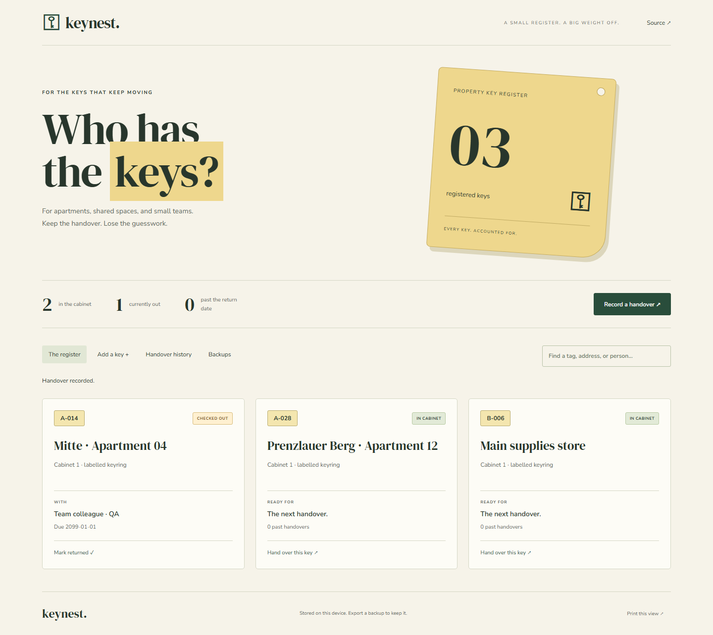

# Keynest

A physical key register for apartments and small teams. Know which key belongs to which property, who currently has it, and when it should come back.

[Open the application](https://goshkaaaa.github.io/keynest/) · [Mobile screenshot](docs/mobile.png)



## What works

Register unique key tags and property references, attach storage/access notes, record a handover with a person and return date, and mark a set returned. Search by tag, property, or holder. The handover history retains issue and return times, and the register shows overdue sets separately.

The application starts empty and creates no example records. A key can have only one open handover. Returned records remain in history. This is an operational log, not an electronic signature system.

## Run and verify

Use Node.js 24 LTS.

```sh
npm ci
npm run dev
npm run lint
npm test
npx playwright install chromium
npm run test:e2e
npm run build
npm run preview
```

Vue 3, JavaScript, Vite, and IndexedDB through `idb`. Builds go to `dist/`. GitHub Pages builds use `/keynest/`; local builds use `/`.

## Your records

Records live in this browser's IndexedDB. Read/write transactions check the latest stored state before committing, so two tabs cannot issue the same key concurrently. Open tabs receive update notifications. Export JSON backups to move the register or keep a separate copy. Restore requires explicit replacement selection, validates the file before writing, and offers an undo during the current session. CSV export preserves handover history and prefixes spreadsheet formula-like values. Print the register or history from the footer.

This is a single-device tool, with no account, shared server, cloud sync, or notifications. Anyone using the same browser profile can access the register. Clearing site data removes local records. Never store door alarm codes in a browser profile you share with untrusted users.

Limits: 1,000 keys, 10,000 handovers, and 10 MB backup imports. Dates use the device's calendar; overdue means the due date is before today. The application does not delete historical handovers or send reminders.

Unit tests cover unique tags, exclusive handovers, returns, real dates, malformed backups, and CSV quoting. Desktop/mobile browser tests cover the complete issue/return flow, persistence, exports, empty startup, and accessibility. Screenshot records were created through the normal application during QA; they are not loaded for visitors.

Optional Google Fonts have local fallbacks. MIT license.
